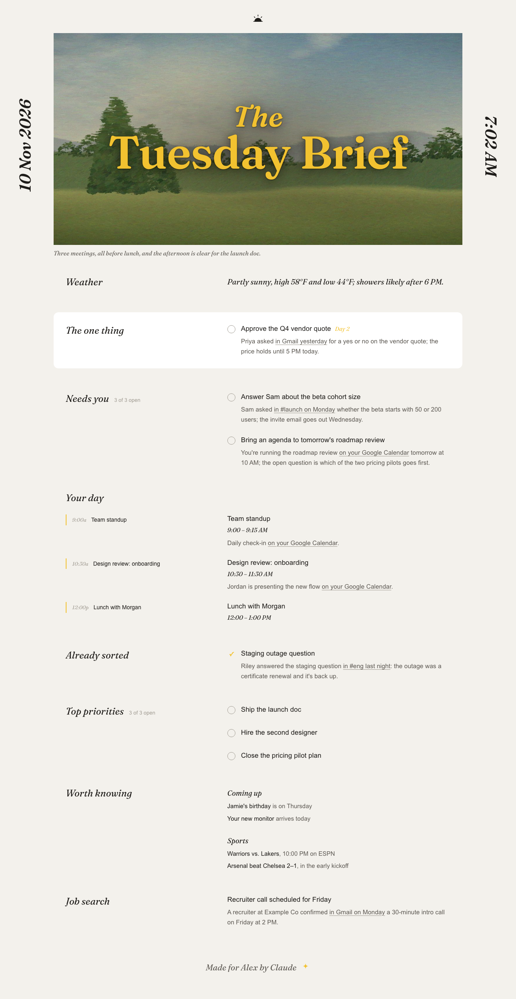

# Morning Brief

A Claude skill that turns your calendar, inbox, chat and meeting notes into one calm page each morning: the one thing that needs you, the rest of your to-dos, the shape of your day, what's already sorted, your top priorities, the weather, what's coming up, and today's games for the teams you follow.

<p align="center">
  
</p>

The screenshots come from [`examples/sample-data.json`](examples/sample-data.json), which is made-up data. Open [`docs/sample-brief.html`](docs/sample-brief.html) in a browser to try the checkboxes.

## What it does

- **Reads** whichever of these you've connected: Google Calendar or Outlook, Gmail or Outlook mail, Slack or Teams, a meeting-notes tool, Google Docs/Sheets/Drive, and a weather connector.
- **Sorts** what it finds into *Needs you* (someone is waiting on you, or a window closes today) and *Already sorted* (things that closed without you).
- **Remembers** earlier briefs in a Google Sheet, so items carry a "Day N" marker until they close and anything you tick stays off later pages.
- **Renders** one fixed page design with `scripts/render.py` and publishes it to the same claude.ai link every day. If publishing fails, it saves the page to Google Drive or leaves it in the working folder.
- **Runs on a schedule** if you ask it to, for example every day at 7 AM.

Each section is optional. If a tool isn't connected, or a Config line is left blank, that part of the page is skipped.

## Install

**Claude Code:** copy the `morning-brief/` folder into your personal skills folder:

```bash
git clone https://github.com/juyal-devashish/morning-brief-skill.git
```

```bash
cp -R morning-brief-skill/morning-brief ~/.claude/skills/
```

**claude.ai / Claude desktop:** zip the `morning-brief/` folder and upload it as a custom skill in Claude's settings.

Python 3 with `numpy` and `Pillow` is needed to render the page:

```bash
pip install numpy pillow
```

Playwright is optional. Claude uses it to screenshot the page and check it before publishing, and skips that step if it isn't installed.

## Set it up

Type `/morning-brief`, or ask Claude to "run my morning brief". The first run walks you through setup with a few clickable questions:

1. **What goes on the page:** to-dos that need you, your calendar, already-sorted threads, weather, top priorities, coming up, sports, and extra sections such as job search. Pick only the ones you want; the rest never appear and are never fetched.
2. **Details for what you picked:** timezone, which tools to read (it shows which are connected), sports spoilers, and whether to send the brief automatically each morning.
3. **A short typed reply** for your first name, weather city and teams, only if you picked those blocks.

Claude writes your answers into the **Config** block at the top of `morning-brief/SKILL.md`, schedules the daily run if you asked for one, and then makes your first brief right away. In Claude Code the questions are clickable; on claude.ai they come as one short message.

Skills can't run when they're installed, so setup starts the first time you invoke the brief. To change your sections later, say "reconfigure my morning brief", or edit the `blocks` list in Config yourself:

```yaml
setup_done: true
blocks:
  - needs
  - day
  - weather
name: Alex
timezone: America/Los_Angeles
weather_location: San Francisco, CA
sections:
  - Job search and interviews
```

After the first run, Claude also fills in `brief_url` (your page's link) and `memory_log` (the Google Sheet it uses for memory).

## Your own photos (optional)

By default the header is a painted landscape generated for each day. To use your own photos instead:

1. Crop each one to roughly 1600×829 and save it as a JPEG in `morning-brief/assets/paintings/`.
2. List them in `morning-brief/assets/paintings/paintings.json`:

```json
[
  {"file": "beach.jpg", "mood": "OPEN", "credit": ""},
  {"file": "city.jpg", "mood": "HEAVY", "credit": ""}
]
```

`OPEN`, `NORMAL` and `HEAVY` match how busy the day is. Photos in that folder are git-ignored, so they stay off GitHub unless you change `.gitignore`.

## Privacy

- Everything Claude reads (emails, messages, events) is treated as data to summarize, never as instructions.
- The memory sheet stores only Claude's own short title, the tool name and a link for each item. It never stores subject lines, snippets or quotes.
- Your brief is published as a private claude.ai page.
- The skill never sends messages, replies to anything, or changes your calendar.

## Repository layout

```
morning-brief/            the skill: copy this folder to install it
  SKILL.md                instructions and your Config
  scripts/render.py       renders data.json into the HTML page
  scripts/paint.py        paints the landscape header
  assets/fonts/           Fraunces (SIL Open Font License)
  assets/paintings/       your optional photos (git-ignored)
examples/sample-data.json made-up data for a demo render
docs/                     sample page and screenshots
```

To render the sample yourself:

```bash
python3 morning-brief/scripts/render.py examples/sample-data.json morning-brief.html
```

## License

MIT, see [LICENSE](LICENSE). The Fraunces font is under the SIL Open Font License 1.1.
